# MzaziCare

**Emergency help for older people living at home.** An elder presses one button. The
system works out how serious it is, asks the people who look after them in order, and
keeps moving until somebody says they are coming.

<table>
<tr>
<td align="center">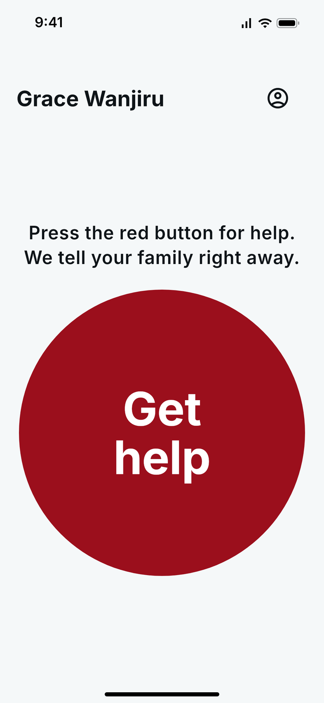</td>
<td align="center">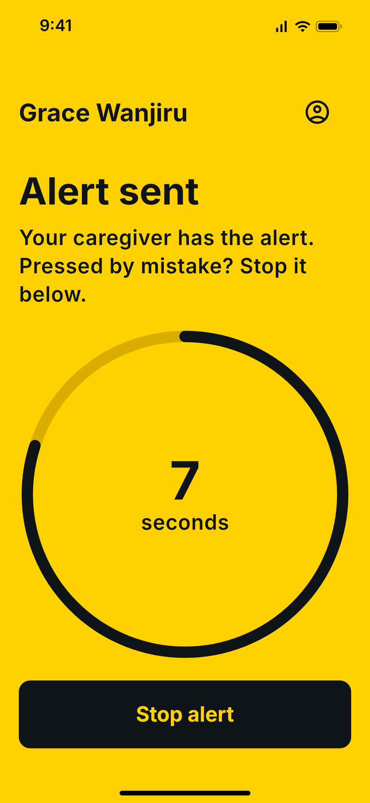</td>
<td align="center">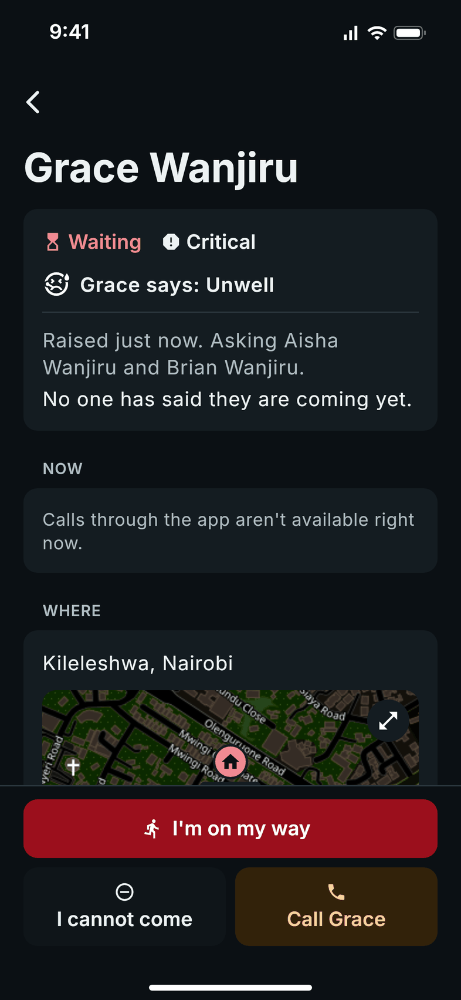</td>
<td align="center">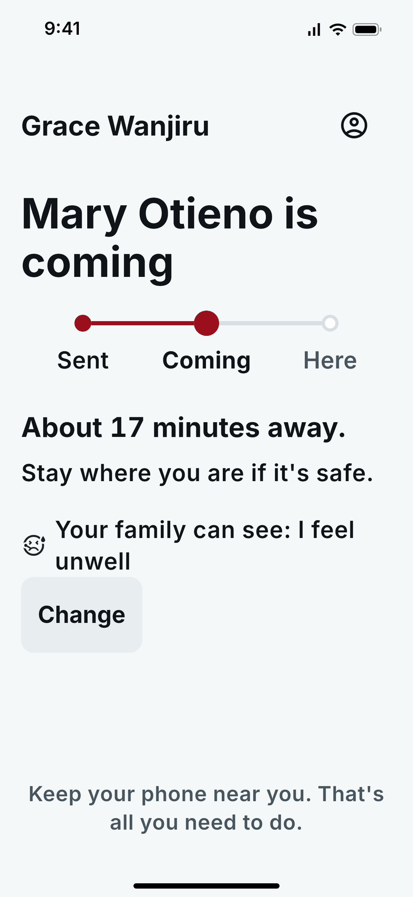</td>
</tr>
<tr>
<td align="center"><sub>One button</sub></td>
<td align="center"><sub>Ten seconds to stop a mistake</sub></td>
<td align="center"><sub>The caregiver is asked</sub></td>
<td align="center"><sub>The elder sees who is coming</sub></td>
</tr>
</table>

Final year project, Strathmore University. It has three parts: a phone app for elders
and the people who help them, a web console for administrators, and the server behind
both. **It is not a medical device** and does not replace emergency services.

## Results

| Measure | Result |
| --- | --- |
| **System tests** | All 12 passed (TC-01 to TC-12), from raising an alert to closing it |
| **Automated tests** | 1,417 passing: 914 server, 21 integration, 388 app, 94 console |
| **Escalation speed** | An unanswered alert moved to the next group 57 ms after its time limit |
| **Two people answering at once** | Exactly one accepted, in 20 of 20 trials |
| **Live updates** | The elder's circle saw a change in 16 ms, and an outsider saw nothing |
| **Access control** | Six attempts without a relationship or role were all refused |

Every figure, the evidence behind it and the limits of the testing are in
**[docs/results.md](docs/results.md)**. The main limit: push notifications and text
messages were logged, not sent to real phones.

## How it works

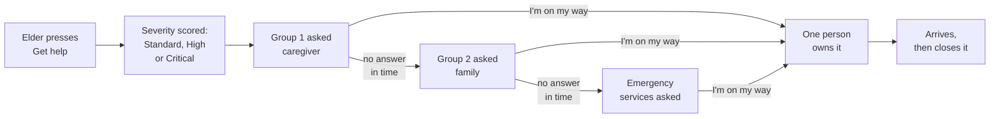

1. **The alert goes at the press.** The elder then has ten seconds to stop it if it was a
   mistake.
2. **The server scores it** from five weighted factors, such as the elder's care level and
   the time of day. The score sets how fast the next steps move.
3. **People are asked in groups**, by push notification, and by text message when push
   cannot get through. Each group has a time limit.
4. **Nobody answering moves it on**, first to the family and then to the emergency
   services nearest the elder. Saying "I cannot come" moves it on at once.
5. **The first person to accept owns it.** They can share their way there, so the elder
   sees how far away help is.
6. **They close it** and record how it ended. Every step is kept in an audit trail.

A fuller explanation, with the design behind it: **[docs/overview.md](docs/overview.md)**.

## What the elder sees

<table>
<tr>
<td align="center"><br><sub>1. Press for help</sub></td>
<td align="center"><br><sub>2. Sent, with ten seconds to stop it</sub></td>
<td align="center">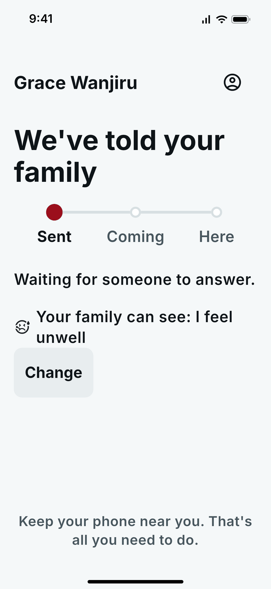<br><sub>3. Told the family, and said what is wrong</sub></td>
<td align="center"><br><sub>4. Help is coming</sub></td>
</tr>
</table>

The elder's screens use larger text and bigger buttons. After pressing, the elder can
tap or say what is happening (a fall, chest pain, feeling unwell, fire, not safe), and
the right service is asked. With no data on the phone, the app offers texting HELP or
calling instead.

## What the caregiver sees

<table>
<tr>
<td align="center">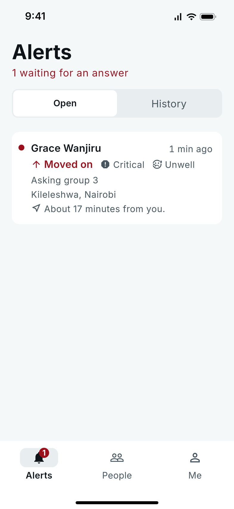<br><sub>1. An alert is waiting</sub></td>
<td align="center">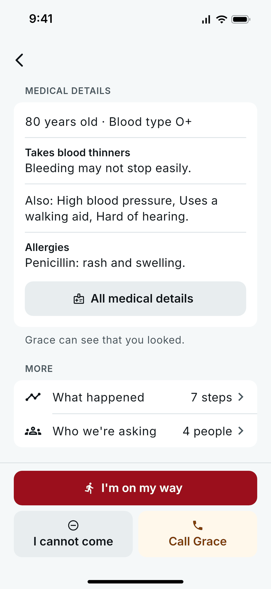<br><sub>2. What they need to know</sub></td>
<td align="center">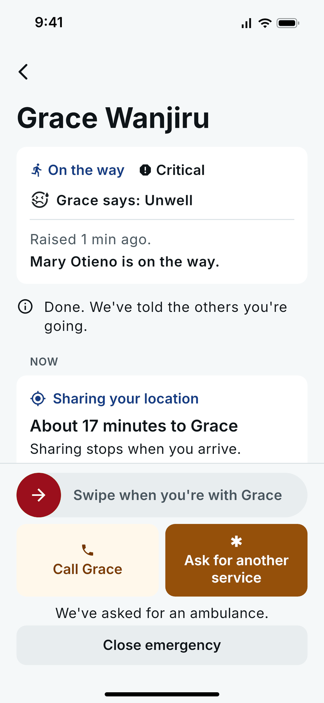<br><sub>3. On the way</sub></td>
<td align="center">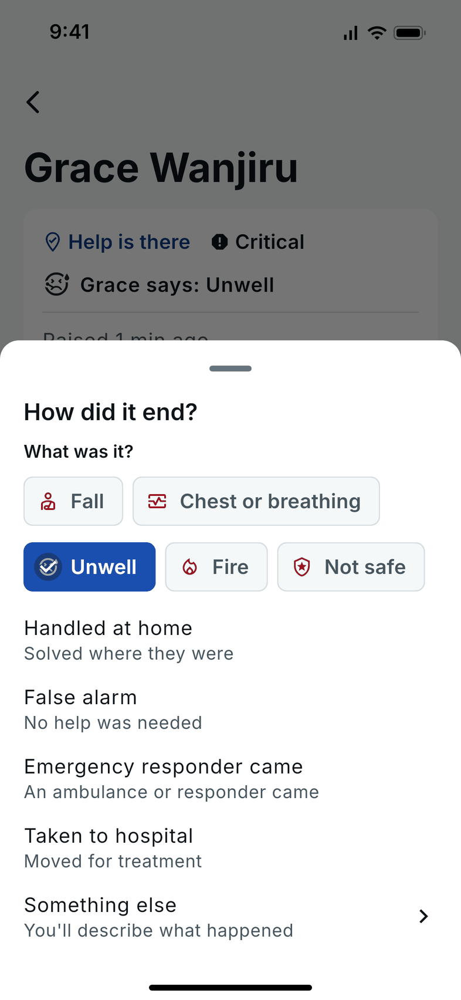<br><sub>4. Closing it</sub></td>
</tr>
</table>

Caregivers, family and responders use the same app. They see who needs help, how
serious it is, where the elder is on a map, and the medical details that matter, if the
elder agreed to share them. They can also answer an alert by replying to its text
message, with 1 or 2 or in their own words in English, Swahili or Sheng.

## What the administrator sees

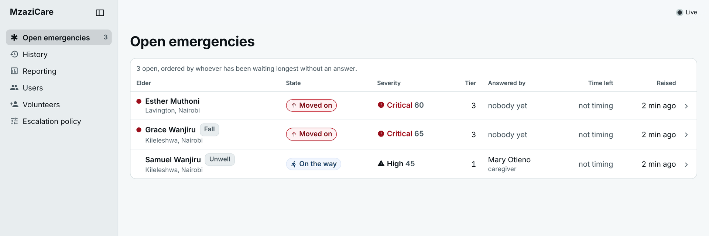

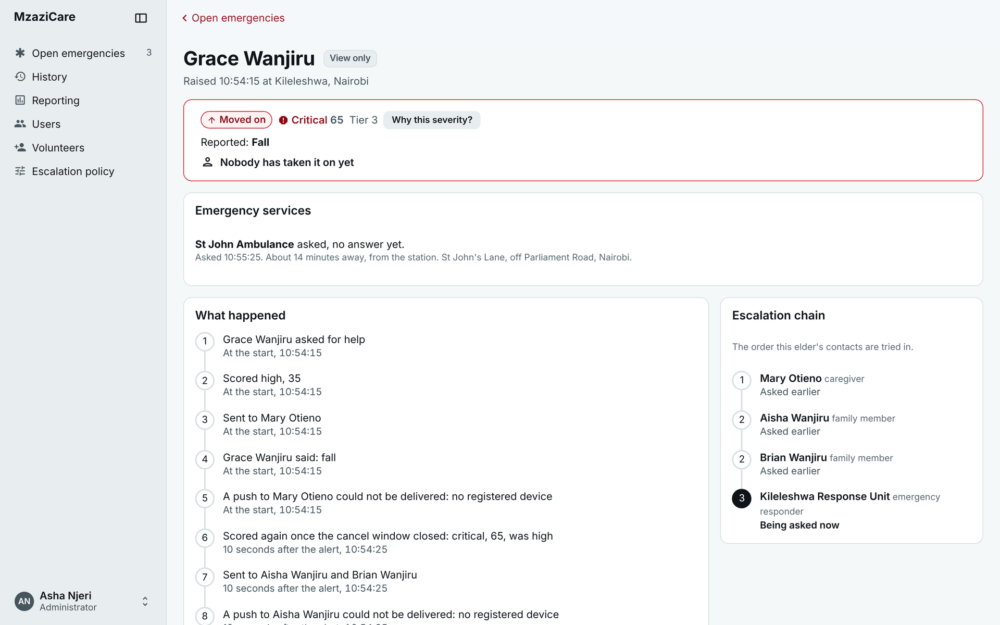

The web console shows every open emergency as it happens, the full record of each one,
reporting figures, user management and the escalation policy. It can watch an emergency
but cannot act on one: only the people in an elder's circle can.

## Everything it offers

| Feature | What it does |
| --- | --- |
| **Asking for help** | One button, a ten second cancel window, and help by text or call when there is no data |
| **Saying what is happening** | Five types by tap or by voice, each asking the right service: ambulance, police or fire |
| **Escalation** | Groups asked in order with time limits, set per severity and editable by an administrator |
| **Reaching people** | Push, text message fallback, replies by text, and voice calls through the app |
| **Finding the way** | A map, road travel times, and live sharing of the helper's way there |
| **Medical details** | Shown to helpers on an open alert, with the elder's consent, and every look recorded |
| **Daily check-ins** | "Are you all right?" at agreed times; a missed one raises an alert |
| **Voice** | "Hey Siri, MzaziCare help", and speech written down by the project's own server |
| **Community volunteers** | Vetted neighbours asked alongside the family for critical alerts |
| **Privacy** | Consent the elder confirms and can withdraw, enforced retention, and a privacy notice |
| **Console** | Live board, full records, reporting, users, volunteers and the escalation policy |
| **Light and dark** | Both, in the app and the console, following the device |

See them all, screen by screen: **[docs/features.md](docs/features.md)**.

## What it is built with

| Part | Technology | Folder |
| --- | --- | --- |
| Server | NestJS, PostgreSQL (Prisma), Redis | [`backend/`](backend) |
| App | Flutter, for iOS and Android | [`frontend/mobile/`](frontend/mobile) |
| Console | React and Vite | [`frontend/dashboard/`](frontend/dashboard) |
| Design tokens | One source for every colour and size, with a contrast check | [`frontend/design-tokens/`](frontend/design-tokens) |

## Run it

```bash
docker compose up -d      # Postgres and Redis
npm run dev               # the API, on port 3000
npm run dev:dashboard     # the console, on port 5173
```

Sign in to the console at http://localhost:5173 with `+254700000001` and `Dev!2026`.
First time on a new machine? Follow **[docs/running](docs/running/README.md)**.

## Documentation

| To | Read |
| --- | --- |
| Understand how it works | [Overview](docs/overview.md) |
| See every feature | [Feature tour](docs/features.md) |
| See what was tested | [Results](docs/results.md) and the [evidence](docs/evidence) |
| Run it | [Running the system](docs/running/README.md) |
| Test it | [Testing](docs/testing.md), [the API with Postman](docs/api-testing.md) |
| Call the API | [API reference](docs/api.md) |
| Understand the code | [Architecture](docs/architecture.md), [module guide](docs/module-guide.md) |
| Know why a choice was made | [Decisions](docs/decisions/README.md) |
| Follow the design rules | [Design language](docs/design-language.md), [PRODUCT.md](PRODUCT.md), [DESIGN.md](DESIGN.md) |

The full list is in [docs/README.md](docs/README.md).
