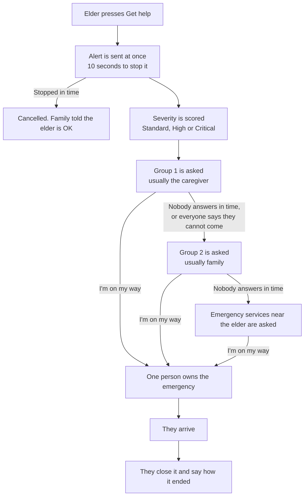
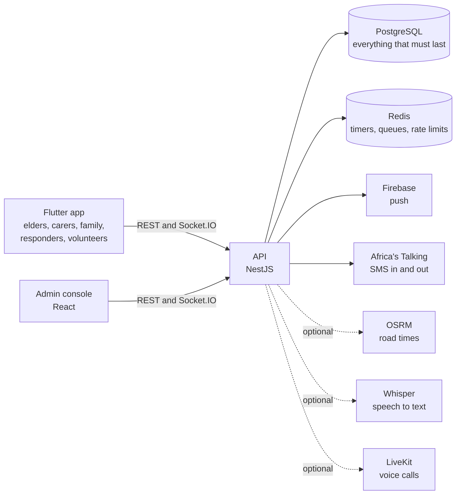

# How MzaziCare works

A ten-minute read. For the screens, see the [feature tour](features.md). For the code
behind each mechanism, see [architecture](architecture.md).

## The problem

An older person living at home has a fall, chest pain or a fright, and the people who
would help do not know. Calling round takes time the person may not have, and the first
number tried may not answer.

MzaziCare makes asking for help one press, and makes sure the request keeps moving until
somebody takes it on.

## Who uses it

| Person | What they use | What they do |
| --- | --- | --- |
| Elder | The app, in Elder mode (larger text and buttons) | Presses for help, says what is happening, sees who is coming |
| Caregiver | The app | Sets up the elder's care circle, answers alerts, closes them |
| Family member | The app, or plain text messages | Answers alerts when the caregiver cannot |
| Emergency responder | The app, or text messages | A response unit, ambulance, police or fire station asked when the family cannot come, or at once for some emergencies |
| Community volunteer | The app | A vetted neighbour asked alongside the family for critical alerts, if the elder agreed |
| Administrator | The web console | Watches every open emergency, reads the record, manages users and the escalation policy |

## The life of an alert

1. **The press.** The alert goes to the server the moment the button is pressed. The ten
   seconds that follow are for stopping a mistake, not a delay before sending.
2. **Severity.** The server adds up five weighted factors: the elder's care level, whether
   the alert was left to run, the time of day, whether the elder is away from home, and
   whether there was a recent alert. The total (0 to 100) falls into Standard, High (35 and
   over) or Critical (60 and over). Every factor's contribution is stored, so the score
   can be explained afterwards.
3. **Asking in order.** Each elder has a chain of people in groups. Everybody in a group is
   asked at once. Each group has a time limit that depends on the severity: by default two
   minutes for a Standard alert and one minute for a High or Critical one.
4. **Moving on.** When the time runs out, or everybody asked says they cannot come, the
   next group is asked. The last step is the emergency services nearest the elder's home.
   An alert never stops by itself.
5. **Taking it on.** The first person to say "I'm on my way" owns the emergency. If two
   people press at the same moment, one wins and the other is told who is going.
6. **Closing.** Whoever went records how it ended: handled at home, a false alarm, a
   responder came, taken to hospital, or something else.

Every step is written to an audit trail with its time, who did it and the state before and
after.

## What makes it more than a timer

- **What is happening.** The elder can tap or say fall, chest pain or breathing, unwell,
  fire or not safe. Fire, danger and breathing trouble ask the fire service, police or an
  ambulance about 25 seconds later, without waiting for the family to fail first.
- **Messages that get through.** Push notifications first, a text message when push cannot
  be delivered, and at once for critical alerts. Anybody can answer an alert by replying
  to the text with 1 or 2, or in their own words in English, Swahili or Sheng.
- **No data on the elder's phone.** The app offers texting HELP, texting the family or
  calling, and keeps trying to send the alert.
- **Where people are.** The helper who is going can share their way there, so the elder
  sees "About 17 minutes away" and others see the route on a map. Sharing stops on arrival
  and is not kept.
- **Medical details.** With the elder's own consent, the people asked to help see what
  changes what they should do: blood thinners, allergies, conditions. Every look is
  recorded and the elder can see who looked.
- **Daily check-ins.** Optional. "Are you all right?" at agreed times. A missed check-in
  becomes an ordinary alert.
- **Voice.** "Hey Siri, MzaziCare help" raises the alert. After the press, the elder can
  say what is happening and a speech server the project runs itself writes it down.

## How it is built

| Part | Technology | Where |
| --- | --- | --- |
| API | NestJS, Prisma, PostgreSQL, Redis, BullMQ | [`backend/`](../backend) |
| App | Flutter (iOS and Android) | [`frontend/mobile/`](../frontend/mobile) |
| Console | React, Vite | [`frontend/dashboard/`](../frontend/dashboard) |
| Design tokens | One JSON file that generates colours and sizes for both, with a contrast check | [`frontend/design-tokens/`](../frontend/design-tokens) |

Three choices shape the rest:

- **Timers are Redis keys that expire.** A group's time limit is a key with a time to live.
  Its expiry moves the alert on within a second. The deadline is also stored in the
  database and checked every 15 seconds, so a restart or a Redis that drops an event
  slows escalation down instead of stopping it.
- **The database decides races.** Taking an alert on is one conditional write, so two
  people cannot both own it.
- **Rules, not a model.** Severity, the reading of replies and the reading of speech are
  all rules an administrator can read and change. A safety decision has to be explainable.

More in [architecture](architecture.md) and the [decision record](decisions/README.md).

## What it is not

It is not a medical device. It detects nothing by itself: somebody has to press, speak
or miss a check-in. It does not replace emergency services. It has been tested on one
machine with logged, not real, push and SMS delivery; see [results](results.md).
